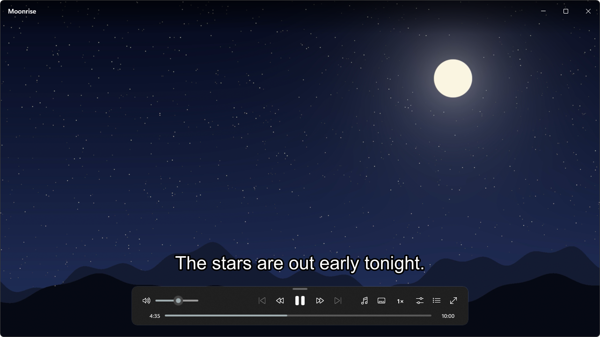
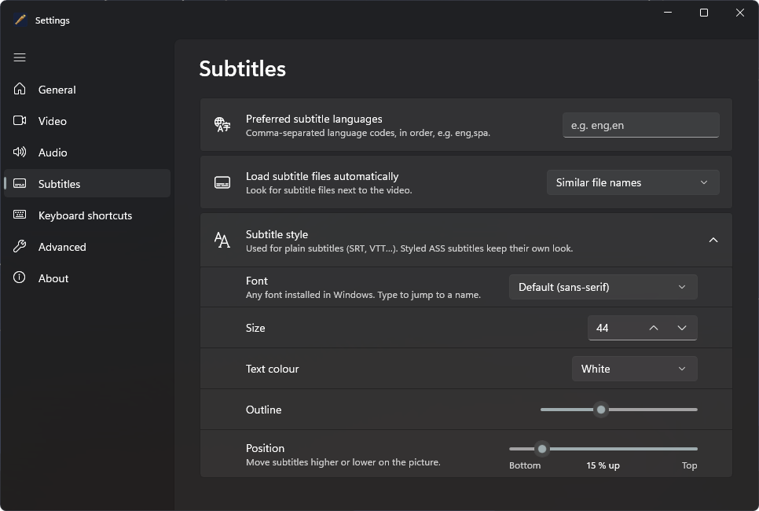
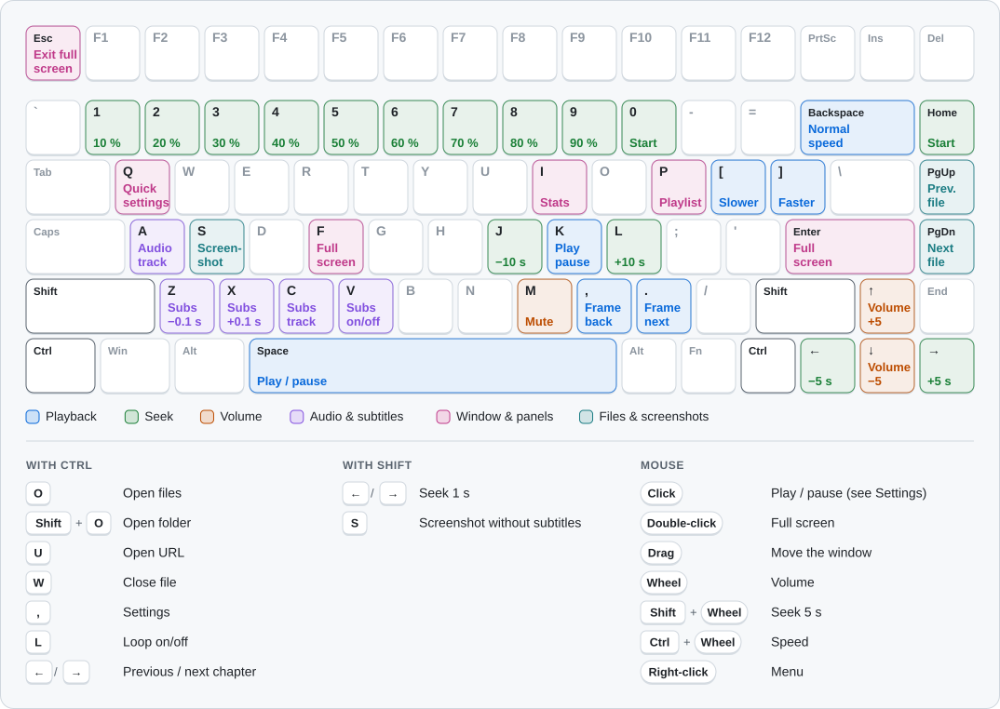

<p align="center">
  
</p>

<h1 align="center">Otear</h1>

A modern media player for Windows 11 built on [mpv](https://mpv.io) (libmpv 0.42) with a native WinUI 3 interface.


<p align="center"><em>Playing a video with the floating control bar. The subtitles are raised 15 % with the position setting.</em></p>

> [!IMPORTANT]
> Made in the spirit of [IINA](https://iina.io) on macOS.

- **High-quality playback**: mpv's `gpu-next` renderer (libplacebo) on Direct3D 11 with zero-copy
  hardware decoding (D3D11VA). 4K/8K, H.264, H.265/HEVC (8/10-bit), AV1, VP9 and everything FFmpeg reads,
  in MKV, MP4, MOV, WebM, TS and more.
- **HDR**: HDR10, HLG and Dolby Vision (profiles 5, 8 and 7 FEL via libplacebo). When Windows HDR is on,
  video is passed through in PQ/BT.2020 and tone-mapped only above your display's peak brightness; on SDR
  displays it is tone-mapped by libplacebo.
- **Modern and responsive UI**: floating acrylic control bar (or a bottom bar) that auto-hides with the cursor and can be
  dragged anywhere in the window (double-click its handle to put it back), seek bar with chapter marks and
  thumbnail previews, track menus for audio/subtitles, speed slider (0.05× steps), right-click menu.
- **Subtitle style** in Settings: font (any installed font), size, colour, outline and vertical position.
- **Sidebars**: playlist (reorder, add, remove) & chapters; quick settings for video (track, aspect, rotation,
  deinterlace, speed, picture equaliser, stream info), audio (track, device, delay, 10-band equaliser) and
  subtitles (primary/secondary track, load file, delay, size, position).
- **Light and dark themes** (or follow Windows), Mica windows, Windows 11 settings page.
- Resume where you left off, recent files, drag and drop (files, folders, subtitles), single instance,
  window that fits and keeps the video's aspect ratio, full screen, always on top, screenshots.

<p align="center">
  
  <br>
  <em>Settings: subtitle languages, automatic loading and style (font, size, colour, outline, position).</em>
</p>

## Build

Requirements: Windows 11, .NET SDK 10.0.404+, Visual Studio 2022 C++ build tools (only for NativeAOT
release builds), PowerShell 7.

```powershell
pwsh tools/Get-LibMpv.ps1                      # official libmpv 0.42 (GPL) → lib/mpv/win-x64
dotnet build src/Otear/Otear.csproj            # debug build (x64)
src/Otear/bin/x64/Debug/net10.0-windows10.0.26100.0/win-x64/Otear.exe <file>
```

Tests (headless libmpv against generated clips):

```powershell
pwsh tools/New-TestMedia.ps1                   # downloads FFmpeg to .tools/ and makes testmedia/*
dotnet test tests/Otear.Mpv.Tests
```

Release (NativeAOT publish + installer; installer needs Inno Setup 6: `winget install JRSoftware.InnoSetup`):

```powershell
pwsh tools/Build-Release.ps1                   # → artifacts/Otear-<version>-x64-setup.exe
pwsh tools/Build-Release.ps1 -Arch arm64
```

App icon: the artwork lives in `art/otear-icon.jpg`. After changing it, run `pwsh tools/New-AppIcon.ps1` to regenerate
`src/Otear/Assets/Otear.ico` (16–256 px, transparent rounded corners) and `Logo.png`.

Keyboard map: the shortcut image in this README is drawn by `pwsh tools/New-KeyboardMap.ps1` (writes
`docs/keyboard-light.svg` and `docs/keyboard-dark.svg`); update its tables when shortcuts change.

## How it works

`src/Otear.Mpv` is a small AOT-safe binding of libmpv's client API (`MpvClient`: options, properties,
observation, async commands, event thread) plus `PlayerOptions` (the mpv configuration) and
`ThumbnailGenerator` (seek previews from a second, headless mpv core).

`src/Otear` is the WinUI 3 app. mpv runs with `--d3d11-output-mode=composition`: it renders into a window-less
DXGI swap chain whose pointer it exposes as the `display-swapchain` property. `VideoSurface` hands that swap
chain to a XAML `SwapChainPanel` (`ISwapChainPanelNative::SetSwapChain`) and keeps
`--d3d11-composition-size` equal to the panel's pixel size, so all controls are ordinary XAML drawn over the
video. Because mpv cannot see the display in this mode, `HdrDisplayService` reads the monitor's advanced-color
state (`DisplayInformation`) and sets `target-colorspace-hint` / `target-peak`.

Settings, recent files, resume data and logs live in `%LOCALAPPDATA%\Otear`.

## Keyboard and mouse

<picture>
  <source media="(prefers-color-scheme: dark)" srcset="docs/keyboard-dark.svg">
  
</picture>

Keys are shown on a US layout.

<details>
<summary>All shortcuts as text</summary>

| Keys | Action |
| --- | --- |
| **Playback** | |
| <kbd>Space</kbd> or <kbd>K</kbd> | Play / pause |
| <kbd>,</kbd> / <kbd>.</kbd> | Previous / next frame |
| <kbd>[</kbd> / <kbd>]</kbd> | Speed −/+ 0.05× |
| <kbd>Backspace</kbd> | Normal speed |
| <kbd>Ctrl</kbd> + <kbd>L</kbd> | Loop on/off |
| **Seek** | |
| <kbd>←</kbd> / <kbd>→</kbd> | 5 s back / forward (1 s with <kbd>Shift</kbd>) |
| <kbd>J</kbd> / <kbd>L</kbd> | 10 s back / forward |
| <kbd>1</kbd> … <kbd>9</kbd>, <kbd>0</kbd> | Jump to 10 % … 90 %, back to the start |
| <kbd>Home</kbd> | Back to the start |
| <kbd>Ctrl</kbd> + <kbd>←</kbd> / <kbd>→</kbd> | Previous / next chapter |
| **Volume** | |
| <kbd>↑</kbd> / <kbd>↓</kbd> | Volume +5 / −5 |
| <kbd>M</kbd> | Mute |
| **Audio and subtitles** | |
| <kbd>A</kbd> | Next audio track |
| <kbd>C</kbd> | Next subtitle track |
| <kbd>V</kbd> | Subtitles on/off |
| <kbd>Z</kbd> / <kbd>X</kbd> | Subtitle delay −/+ 0.1 s |
| **Window and panels** | |
| <kbd>F</kbd> or <kbd>Enter</kbd> | Full screen |
| <kbd>Esc</kbd> | Close the side panel, or leave full screen |
| <kbd>P</kbd> | Playlist and chapters |
| <kbd>Q</kbd> | Quick settings (video, audio, subtitles) |
| <kbd>I</kbd> | Statistics |
| <kbd>Ctrl</kbd> + <kbd>,</kbd> | Settings |
| **Files and screenshots** | |
| <kbd>Ctrl</kbd> + <kbd>O</kbd> | Open files |
| <kbd>Ctrl</kbd> + <kbd>Shift</kbd> + <kbd>O</kbd> | Open folder |
| <kbd>Ctrl</kbd> + <kbd>U</kbd> | Open URL |
| <kbd>Ctrl</kbd> + <kbd>W</kbd> | Close file |
| <kbd>PgUp</kbd> / <kbd>PgDn</kbd> | Previous / next file |
| <kbd>S</kbd> | Screenshot (<kbd>Shift</kbd> + <kbd>S</kbd>: without subtitles) |
| **Mouse** | |
| Click | Play / pause (or show/hide the controls: Settings › General) |
| Double-click | Full screen |
| Drag | Move the window |
| Wheel | Volume (with <kbd>Shift</kbd>, or tilting the wheel: seek 5 s; with <kbd>Ctrl</kbd>: speed) |
| Right-click | Menu |

</details>

## License

GPL-3.0-or-later. See `LICENSE` and `THIRD-PARTY-NOTICES.md`. The bundled libmpv is the mpv project's GPL build.
